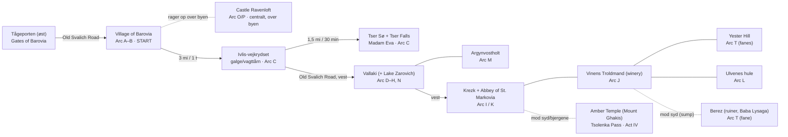

# Barovia — Geografisk oversigt

> [!info]+ **Sådan bruges denne fil**
> Regionskort + et skematisk rejse-diagram så du hurtigt kan se hvor tingene ligger i forhold til hinanden og i hvilken rækkefølge gruppen typisk når dem. Kortene er de kanoniske CoS-dalkort; diagrammet er en forenklet rygrad (søgbar på nøgleord).

## Kort — hele dalen

Dalen løber øst→vest: **Village of Barovia** i sydøst (hvor gruppen starter), **Vallaki** centralt under Lake Zarovich, **Krezk** længst mod vest. Castle Ravenloft rager op centralt, over landsbyen. 1 hex = ¼ mile.

**Med stednavne:**
![[Barovia Valley Map (labels).jpg]]

**Med CoS-bogens markører:**
![[Barovia Valley Map (CoS markers).jpg]]

---

## Skematisk rejse-rygrad (Den Gamle Svalich-vej)

Vejen er dalens rygrad. Gruppen bevæger sig grundlæggende **øst → vest** gennem kampagnen. Sydlige lokationer er sidegrene.

> [!note] Diagrammet er **skematisk** (rækkefølge + naboskab), ikke måltro. Brug kort-billederne ovenfor til præcis geografi.

---

## Verificerede rejsetider (CoS:R)

| Fra → til | Afstand | Tid |
|---|---|---|
| Village of Barovia → Ivlis-vejkrydset | 3 mi | 1 time |
| Ivlis-vejkrydset → Tser Sø (lejr) | 1,5 mi | 30 min |
| Ivlis-vejkrydset → Tser Falls | 7,5 mi | 2,5 timer |

*(Vestlige etaper — Vallaki, Krezk — kan tilføjes når vi verificerer tallene fra CoS:R Chapter 2. Sig til hvis du vil have dem fyldt ud.)*

---

# Linked
- [[Arc B - Welcome to Barovia (DK)]] · [[Arc C - Into the Valley (DK)]]
- [[Tid og Kalender (DK)]] · [[Reveal Timeline (DK)]]
